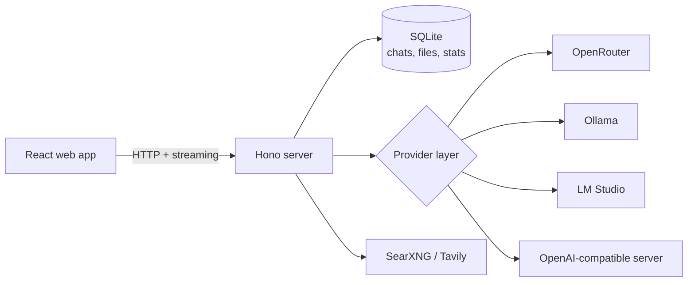

# AGENTS.md

Technical notes for anyone (human or AI agent) working on the OpenChat code. User-facing setup lives in [README.md](README.md).

## What it is

A self-hosted chat app for [OpenRouter](https://openrouter.ai) and local models ([Ollama](https://ollama.com), [LM Studio](https://lmstudio.ai), or any OpenAI-compatible server). OpenRouter is optional: with only a local server, every text feature works with no account or key.

Main features: a Model Library with live prices; versioned edits and regenerations; **Compare** (one message to up to four models); **Discussions** (models debate, with an optional moderator); forking and summarize-and-continue; image/PDF/text attachments and model-written files; web search (OpenRouter's, or SearXNG / Tavily for local models); image and video generation; memories, custom instructions and saved prompts; cost/token/speed stats with spending limits; full export/import as a zip.

## Architecture



- **Server** (`server/`): TypeScript on [Hono](https://hono.dev) with [better-sqlite3](https://github.com/WiseLibs/better-sqlite3). Replies stream to the browser over server-sent events.
- **Web app** (`web/`): React 19 and [Vite](https://vite.dev).
- **Shared types** (`shared/`): used by both server and web app.
- **Provider layer:** every chat feature goes through one interface, and each model id decides whether a request goes to OpenRouter or to a local server. Adding another kind of server means writing one client.
- **Data:** everything lives in one SQLite file (`data/openchat.db` by default).
- **Privacy rule:** chats that only used local models are never sent to OpenRouter, not even to write their title. Keep it that way.

## Local servers

| Server | Detection |
|---|---|
| Ollama | Automatic at `http://localhost:11434` |
| LM Studio | Automatic at `http://localhost:1234` |
| Any OpenAI-compatible server (llama.cpp, vLLM, …) | Added in **Settings → General → Local servers** |

Each local model has its own context window setting (16,384 tokens by default). OpenChat sends it to Ollama on every request and asks before sending a chat that no longer fits. LM Studio support follows its documented API but has had less testing than Ollama.

## Configuration

Settings are made in the app. A `.env` file (see `.env.example`) can also set:

| Variable | Default | Purpose |
|---|---|---|
| `OPENROUTER_API_KEY` | none | OpenRouter key, used when none is saved in Settings |
| `OPENCHAT_PORT` | `3000` | Port the app listens on |
| `OPENCHAT_HOST` | `127.0.0.1` | Address to listen on; `0.0.0.0` lets other machines connect (the Docker image sets this) |
| `OPENCHAT_ALLOWED_HOSTS` | none | Names besides `localhost` and IP addresses that OpenChat answers on, comma-separated, e.g. `homelab.local` |
| `OPENCHAT_DETECT_HOST` | `localhost` | Machine to look for Ollama and LM Studio on (`host.docker.internal` in Docker) |
| `OPENCHAT_DB` | `data/openchat.db` | Location of the SQLite database |

Other host names are refused to block DNS rebinding attacks. OpenChat has no login; see [SECURITY.md](SECURITY.md).

SearXNG needs JSON output enabled in its `settings.yml` (the connection test in Settings explains how).

Backups (Settings → Data) never include API keys. Import replaces all existing data.

## Development

You need Node.js 22.12 or newer.

```bash
npm install
npm run dev        # server and web app with hot reload: http://localhost:5173
npm test           # all tests (Vitest)
npm run typecheck  # TypeScript
npm run fake-local -- --flavor ollama --port 11434   # a fake Ollama for trying the UI without one
npm run fake-search                                  # a fake search server
```

`npm start` builds the web app only when it is stale (`scripts/build-if-stale.mjs`), then serves it from the Hono server on port 3000.

### Tests

1,100+ [Vitest](https://vitest.dev) tests. Local servers and search are tested against fake servers over real HTTP (`test/fakeLocalServer.ts`, `test/fakeSearchServer.ts`), so the suite needs no network, keys or GPU. Run `npm test` and `npm run typecheck` before opening a pull request; CI runs both.

## Process

OpenChat was built by directing an AI coding agent ([Claude Code](https://claude.com/claude-code)): each feature started as a design spec, became a step-by-step plan, and was built task by task with a review of each task and a final review of the whole change. Specs and plans are in [`docs/superpowers`](docs/superpowers). Follow the same pattern for new features.

## Brand assets

Logo files are in `docs/brand/` (banner, PNG, light/dark SVGs). Web favicons are in `web/public/`.

## Roadmap

- A login option, or multiple account support
- More testing with LM Studio
- Image generation inside an existing text chat
