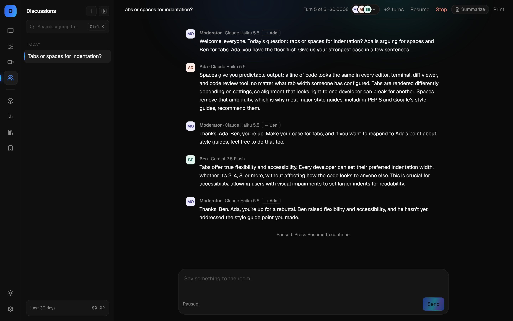
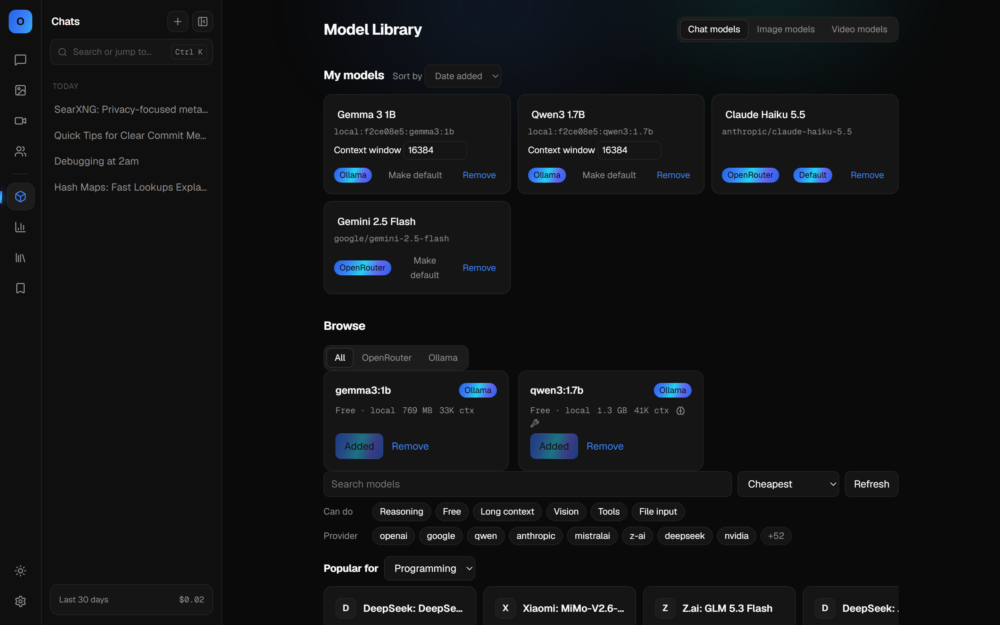
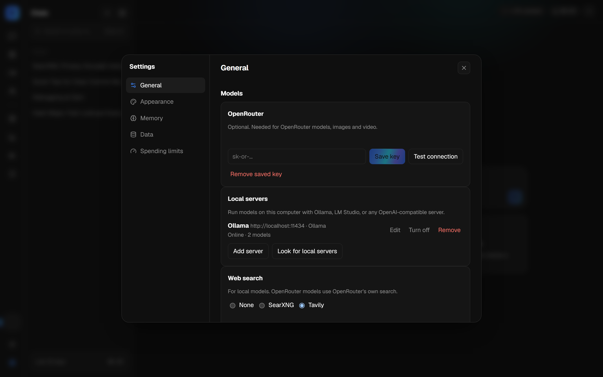
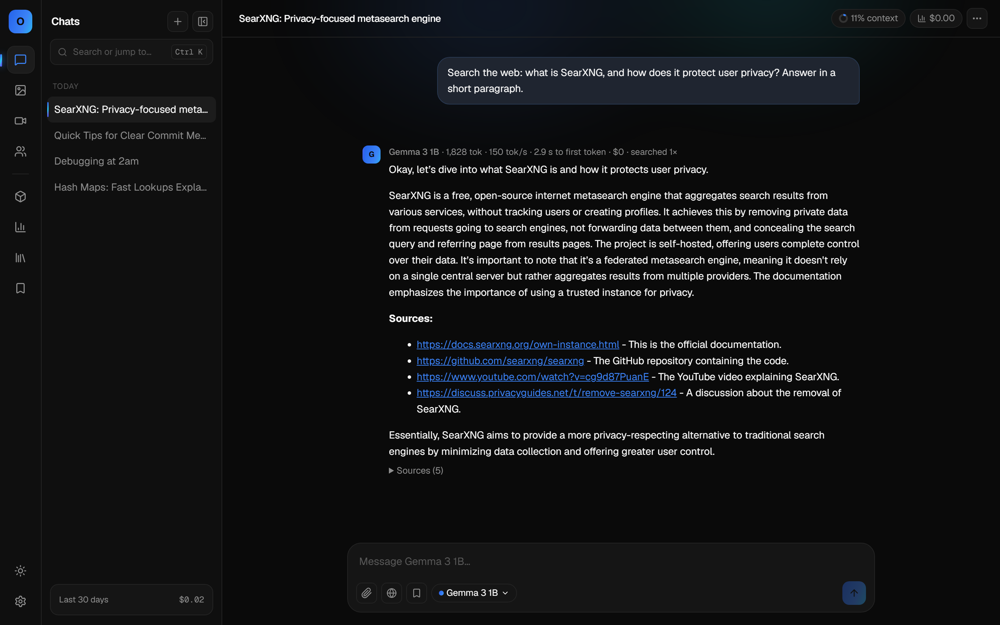
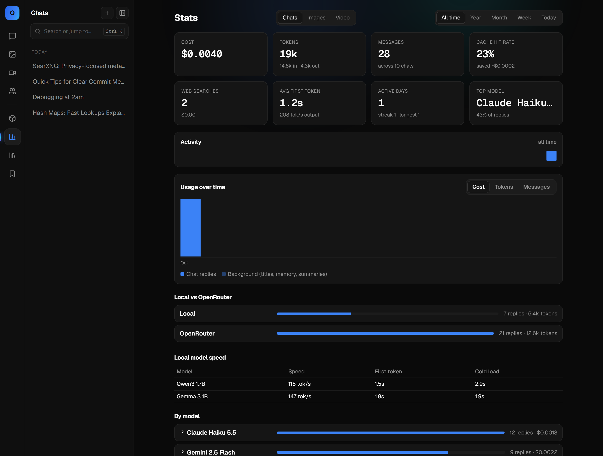
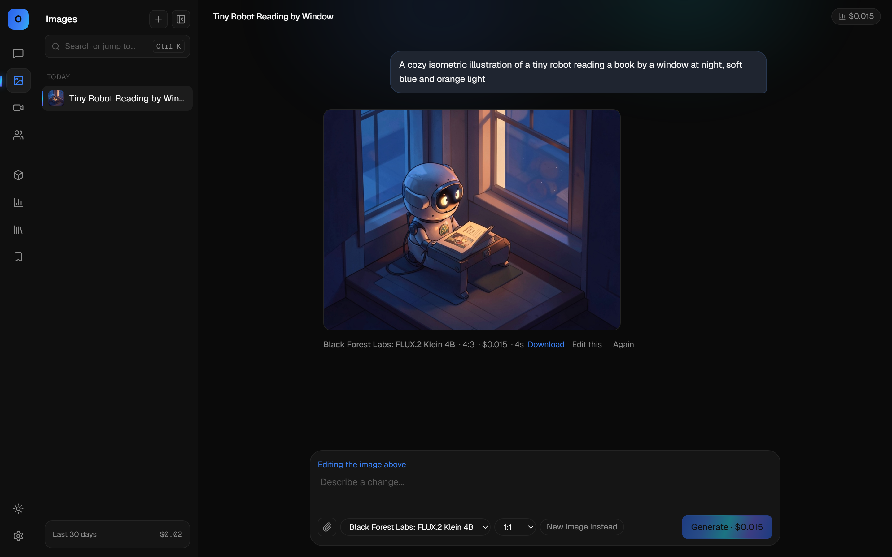
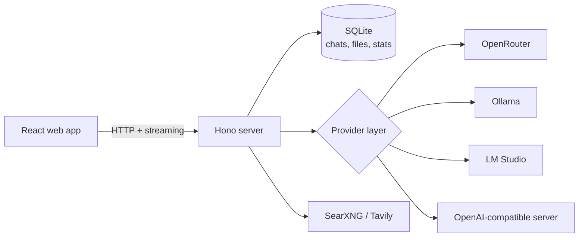

# OpenChat

**A self-hosted chat app for [OpenRouter](https://openrouter.ai) and your own local models.**

Chat with hundreds of cloud models through one OpenRouter key, or run fully offline with [Ollama](https://ollama.com) or [LM Studio](https://lmstudio.ai) and no key at all. Compare models side by side, let them debate each other, keep every version of every reply, and see exactly what each conversation cost.

[](https://github.com/MJHax/OpenChat/actions/workflows/ci.yml)
[](LICENSE)


## Features

**Models**
- Any model on OpenRouter, browsable and filterable in a built-in Model Library with live prices and rankings.
- Local models from Ollama, LM Studio or any OpenAI-compatible server, found automatically when they run on the same machine.
- OpenRouter is optional: with only a local server, every text feature works with no account, no key and no cost.

**Chat**
- Every edit and regeneration is kept as a version; flip between them with ‹ ›, or regenerate a reply with a different model.
- **Compare** sends one message to up to four models at once and lets you pick the reply to continue with.
- **Discussions** put several models in a room to debate a topic, with an optional moderator that hands over the floor.
- Fork a chat from any reply, or summarize a long chat and continue it fresh.
- Attach images, PDFs and text files; models can also write files that open in a side panel.
- Web search: OpenRouter's built-in search, or [SearXNG](https://docs.searxng.org) / [Tavily](https://tavily.com) for local models, with sources on every reply.
- A thinking toggle and reasoning-effort picker for models that reason.

**Images and video**
- Generate and edit images, and generate short videos, with OpenRouter's image and video models.

**Your data**
- Everything lives in one SQLite file on your machine. Export it all as a zip, or delete chats, images, videos or discussions by kind.
- About me, custom instructions and memories are added to every chat; saved prompts with fill-in slots.
- Stats on cost, tokens and speed, split between local and cloud models, plus daily, weekly and monthly spending limits.
- Chats that only used local models are never sent to OpenRouter, not even to write their title.

## Screenshots

| | |
|---|---|
|  **Compare** a local model and a cloud model side by side, with speed and cost on each reply. |  **Discussions:** models debate a topic while a moderator passes the floor. |
|  **Model Library:** local models next to the OpenRouter catalog. |  **Settings:** OpenRouter is optional; Ollama is detected automatically. |
|  **Web search** for local models, with sources. |  **Stats:** cost, tokens and local model speed. |



## Quick start

You need [Node.js](https://nodejs.org) 22 or newer.

```bash
git clone https://github.com/MJHax/OpenChat.git
cd OpenChat
npm install
npm start
```

Open http://127.0.0.1:3000, then pick one or both:

- **Local models (free, private):** install [Ollama](https://ollama.com), download a model with `ollama pull qwen3:1.7b`, and open **Model Library** in OpenChat. Ollama is found automatically; click **Add** on the model.
- **OpenRouter (hundreds of cloud models):** create a key at [openrouter.ai/keys](https://openrouter.ai/keys), paste it in **Settings → General → OpenRouter**, then add models from the **Model Library**.

## Local models

OpenChat talks to three kinds of local server:

| Server | Setup |
|---|---|
| Ollama | Found automatically at `http://localhost:11434` |
| LM Studio | Start its local server; found automatically at `http://localhost:1234` |
| Any OpenAI-compatible server (llama.cpp, vLLM, …) | **Settings → General → Local servers → Add server** |

A server on another machine on your network can be added by address the same way. Each local model has its own context window setting (16,384 tokens by default). OpenChat sends it to Ollama on every request, and asks before sending a chat that no longer fits, so a local model never silently forgets the start of a conversation.

LM Studio support follows its documented API but has had less testing than Ollama.

## Configuration

Settings are made in the app. A `.env` file (see `.env.example`) can also set:

| Variable | Default | Purpose |
|---|---|---|
| `OPENROUTER_API_KEY` | none | OpenRouter key, used when none is saved in Settings |
| `OPENCHAT_PORT` | `3000` | Port the app listens on |
| `OPENCHAT_DB` | `data/openchat.db` | Location of the SQLite database |

**Web search for local models:** in **Settings → General → Web search**, choose SearXNG (your instance's address; JSON output must be enabled in its `settings.yml`, and the connection test tells you how) or Tavily (an API key; the free tier includes 1,000 searches a month).

OpenChat only listens on `127.0.0.1` and has no login, so it is meant for one person on one machine.

## How it works



- **Server:** TypeScript on [Hono](https://hono.dev) with [better-sqlite3](https://github.com/WiseLibs/better-sqlite3). Replies stream to the browser over server-sent events.
- **Web app:** React 19 and [Vite](https://vite.dev).
- **Provider layer:** every chat feature goes through one interface, and each model id decides whether a request goes to OpenRouter or to a local server. Adding another kind of server means writing one client.
- **Tests:** 1,100+ [Vitest](https://vitest.dev) tests. Local servers and search are tested against fake servers over real HTTP, so the suite needs no network, keys or GPU.

## Development

```bash
npm run dev        # server and web app with hot reload: http://localhost:5173
npm test           # all tests
npm run typecheck  # TypeScript
npm run fake-local -- --flavor ollama --port 11434   # a fake Ollama for trying the UI without one
```

## How it was built

OpenChat was built in about a week by directing an AI coding agent ([Claude Code](https://claude.com/claude-code)) through a written process: every feature started as a design spec, became a step-by-step plan, and was built task by task with a separate review of each task and a final review of the whole change. The specs and plans are in [`docs/superpowers`](docs/superpowers), and most commits credit the agent as co-author.

## Roadmap

- Docker image and an optional login, for hosting on a home server
- More testing with LM Studio
- More web search services

## Contributing

Issues and pull requests are welcome. Please run `npm test` and `npm run typecheck` before opening a pull request; CI runs both on every pull request.

## License

[MIT](LICENSE)
