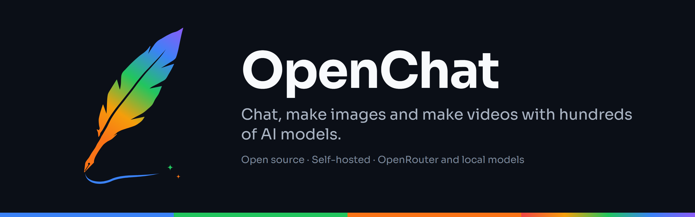
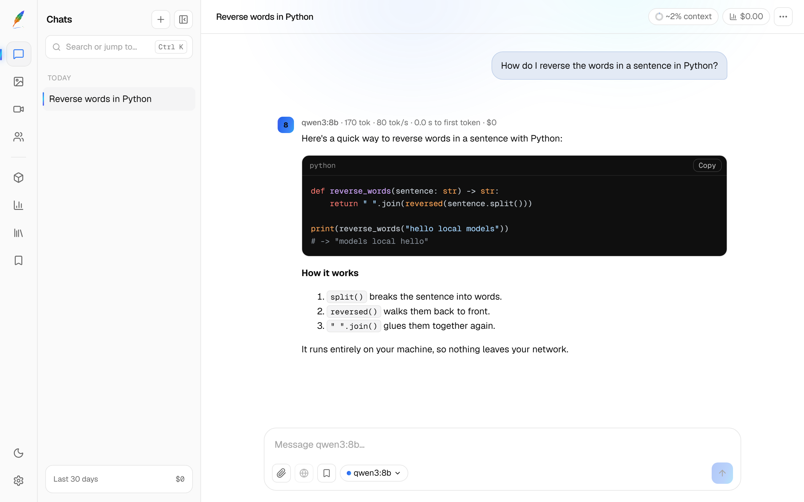

# OpenChat

**A self-hosted chat app for [OpenRouter](https://openrouter.ai) and your own local models.**

Chat with hundreds of cloud models through one OpenRouter key, or stay fully offline with [Ollama](https://ollama.com) or [LM Studio](https://lmstudio.ai), with no account or key needed.



## Set up

You need [Node.js](https://nodejs.org) 22.12 or newer.

```bash
git clone https://github.com/MJHax/OpenChat.git
cd OpenChat
npm install
npm start
```

Open http://127.0.0.1:3000.

## Add models

Pick one or both:

- **Local models (free, private):** install [Ollama](https://ollama.com) and download a model, for example `ollama pull qwen3:1.7b`. In OpenChat, open **Model Library** and click **Add** on the model.
- **Cloud models:** create a key at [openrouter.ai/keys](https://openrouter.ai/keys), paste it in **Settings → General → OpenRouter**, then add models from the **Model Library**.

## Run it on a home server

To use OpenChat from other devices on your network, run it with Docker:

```bash
git clone https://github.com/MJHax/OpenChat.git
cd OpenChat
docker compose up -d
```

Open `http://<server address>:3000` from any device on your network. To update, run `git pull`, then `docker compose up -d --build`.

> [!WARNING]
> OpenChat has no login. Anyone who can reach it can read your chats and use your OpenRouter credit. Only run it on a network you trust, and never expose it to the internet. See [SECURITY.md](SECURITY.md).

## Back up or move your data

In **Settings → Data**, use **Export all data** to save a backup and **Import a backup** to restore it on another machine.

## License

[MIT](LICENSE)
